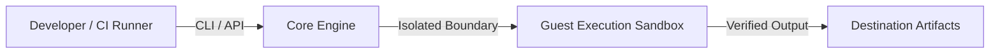
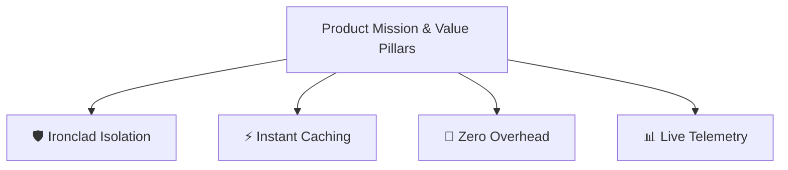

# Product Brochure & Executive Showcase (`/brochure`)

## Overview

Produce an executive, stakeholder-ready product brochure (`docs/brochure.md` or `BROCHURE.md`) for any repository or product. The product brochure translates complex technical systems into clear, compelling value propositions, explicit audience personas, and actionable onboarding steps.

**MANDATORY**: Every product brochure MUST feature rich **embedded Mermaid diagrams** (e.g., system flowcharts, value pillar graphs, architecture previews, or user journey sequences) so stakeholders can understand the product visually at a glance.

---

## When to Use

- Generating an executive product brochure (`docs/brochure.md` or `BROCHURE.md`) for technical leaders, users, and stakeholders
- Updating an existing brochure following major feature releases, performance breakthroughs, or architectural shifts
- Creating marketing hooks, user personas, and visual value matrices for a project

---

## Required Product Brochure Structure

Every brochure must adhere to the following standard structure:

1. **Branding & Header**:
   - Polished project title, bold tagline, status badge row (license, language, platforms/backends, test coverage), and ASCII logo / brand artwork if available.
2. **Product & Marketing Hook**:
   - A bold, compelling elevator pitch capturing the core dilemma and immediate transformation the product delivers.
3. **Target Audience**:
   - Explicit user personas with bullet points explaining how each persona benefits (e.g., Software Engineers, DevOps & CI/CD Teams, Security & Compliance Officers, Multi-Agent Architects).
4. **Purpose & Mission**:
   - Articulation of the problem space, why traditional approaches fail, and the architectural mission (including comparison tables).
5. **Core Value Propositions & Key Features**:
   - Value pillars highlighting tangible benefits with concrete metrics where available.
6. **Embedded Mermaid Visual Diagrams (MANDATORY)**:
   - **System Architecture / Flowchart**: `flowchart TD` or `flowchart LR` showing how components interact.
   - **Value Hierarchy / Decision Flow / User Journey**: Mermaid chart highlighting core workflows or value delivery.
7. **Instant Onboarding & How to Use**:
   - High-impact, copy-pasteable usage examples (one-shot tasks, streaming, persistent workspaces) requiring zero prior domain knowledge.
8. **Where to Go for More Information**:
   - Markdown table linking the technical documentation hub, architecture deep dives, operational how-tos, issue tracker, and community links.

---

## Mermaid Diagram Patterns for Brochures

Use clean, well-styled Mermaid diagrams directly in the brochure Markdown:

### 1. High-Level Flowchart

### 2. Value Pillars Matrix

---

## Step-by-Step Workflow

1. **Analyze Project**: Inspect the codebase, dependencies, tests, and existing documentation.
2. **Identify Value Props**: Determine the core problems solved, target user personas, and distinctive technical advantages.
3. **Author `docs/brochure.md`**:
   - Write crisp, jargon-free copy emphasizing benefits.
   - Embed at least 1-2 Mermaid diagrams.
   - Add concise, verified quick-start examples.
4. **Verify & Validate**:
   - Ensure all Mermaid diagrams render with valid syntax.
   - Verify all links point to existing documentation files.
