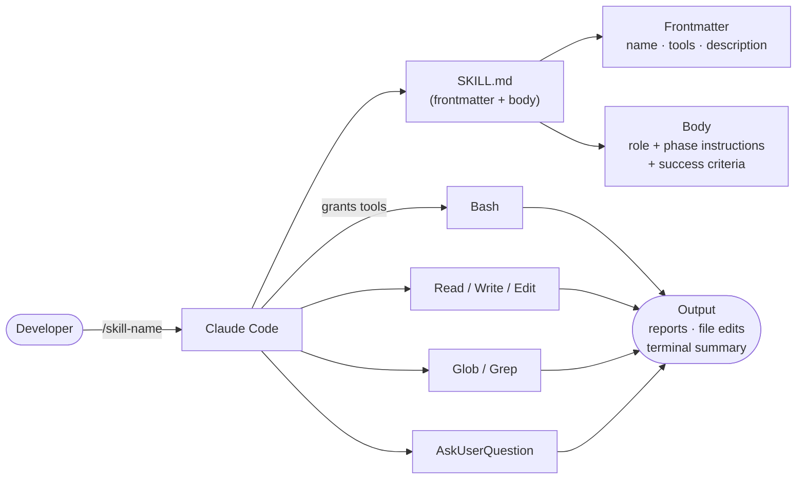
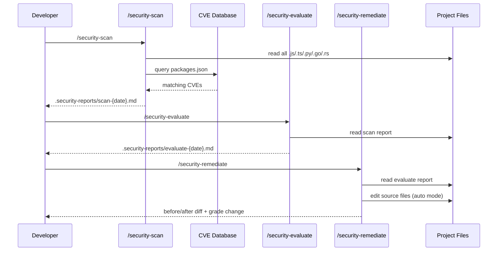

# Architecture

## System Overview

This is a Claude Code skills collection — a set of Markdown prompt files that Claude Code reads and executes as slash commands. There is no runtime binary, no server, and no build step. Each skill is a self-contained `SKILL.md` that declares the tools it needs and defines a step-by-step workflow Claude follows when invoked.

The collection is organized around a security and quality lifecycle: find vulnerabilities, score them, fix them, keep the vulnerability database current, generate tests, and produce documentation.

```
  ┌──────────────────────────────────────────────────────────────────┐
  │                     security-skills collection                   │
  │                                                                  │
  │  ┌──────────────┐  ┌──────────────┐  ┌────────────────────────┐ │
  │  │ /security-   │  │ /security-   │  │  /security-remediate   │ │
  │  │    scan      │─►│  evaluate    │─►│  (auto / suggest /     │ │
  │  └──────────────┘  └──────────────┘  │   interactive)         │ │
  │         │                 │          └────────────────────────┘ │
  │         │    reads        │ reads                               │
  │         ▼                 ▼                                     │
  │  ┌──────────────────────────────────────┐                       │
  │  │   .security-reports/                 │                       │
  │  │     scan-{date}.md                   │                       │
  │  │     evaluate-{date}.md               │                       │
  │  │     remediate-{date}.md              │                       │
  │  └──────────────────────────────────────┘                       │
  │                                                                  │
  │  ┌──────────────┐     ╔══════════════════════════╗              │
  │  │ /security-   │────►║  ~/.claude/security/     ║              │
  │  │  update-cve  │     ║  cve-db/                 ║              │
  │  └──────────────┘     ║    raw/osv-*/, nvd-*.json║              │
  │         ▲             ║    index/packages.json   ║              │
  │  (used  │             ╚══════════════════════════╝              │
  │   by    │                       ▲                               │
  │  scan)  └───────────────────────┘                               │
  │                                                                  │
  │  ┌──────────────┐  ┌──────────────┐                             │
  │  │   /tests     │  │   /docs      │                             │
  │  │              │  │              │                             │
  │  └──────────────┘  └──────────────┘                             │
  └──────────────────────────────────────────────────────────────────┘
          │                    │
          ▼                    ▼
  Project's codebase    Project's docs/
  tests/ reports/       README.md
```

---

## Skill Execution Model

When a user types `/security-scan` in Claude Code, the following happens:

```
  Developer              Claude Code              Skill (SKILL.md)
      │                       │                         │
      │  /security-scan       │                         │
      │──────────────────────►│                         │
      │                       │  1. locate SKILL.md     │
      │                       │        in ~/.claude/    │
      │                       │        skills/          │
      │                       │────────────────────────►│
      │                       │  2. read frontmatter    │
      │                       │     (name, tools,       │
      │                       │      description)       │
      │                       │◄────────────────────────│
      │                       │  3. grant allowed-tools │
      │                       │     to this session     │
      │                       │  4. inject skill body   │
      │                       │     as system prompt    │
      │                       │  5. execute workflow    │
      │                       │─ ─ ─ ─ ─ ─ ─ ─ ─ ─ ─ ─►│
      │                       │      [Bash tool calls]  │
      │                       │      [Read/Write/Edit]  │
      │                       │      [Grep/Glob]        │
      │                       │      [AskUserQuestion]  │
      │                       │◄─ ─ ─ ─ ─ ─ ─ ─ ─ ─ ─ ─│
      │  output / files       │                         │
      │◄──────────────────────│                         │
```



---

## Skill Anatomy

Every skill follows this structure:

```
skill-name/
└── SKILL.md
      ├── --- (YAML frontmatter) ---
      │     name: skill-name
      │     version: 1.0.0
      │     description: |
      │       Trigger conditions — what user phrases activate this skill.
      │     allowed-tools:
      │       - Bash
      │       - Read
      │       - Write
      │       ...
      │   ---
      │
      └── ## Role
          One sentence grounding Claude's expertise for this task.

          ## Instructions
          Phase 1 — ...
          Phase 2 — ...
          ...

          ## Success criteria
          - [ ] Verifiable outcome 1
          - [ ] Verifiable outcome 2
```

**Frontmatter fields:**

| Field | Required | Purpose |
|-------|----------|---------|
| `name` | Yes | Canonical name — must match directory name |
| `version` | Yes | Semantic version for tracking changes |
| `description` | Yes | Natural-language trigger conditions Claude uses to decide when to activate the skill |
| `allowed-tools` | Yes | Whitelist of tools the skill may invoke |

---

## Component Map

### `/security-scan`

**Location**: `security-scan/SKILL.md`
**Responsibility**: Static analysis of all JS/TS/Python/Go/Rust source files; produces a graded security report
**Interfaces**: Invoked as `/security-scan`; reads project source files; writes `.security-reports/scan-{date}.md`
**Dependencies**: Optionally reads `~/.claude/security/cve-db/index/packages.json`

```
security-scan/
└── SKILL.md    — discovery → classify → OWASP check → CVE lookup → CVSS score → report
```

### `/security-evaluate`

**Location**: `security-evaluate/SKILL.md`
**Responsibility**: Deep risk scoring — validates CVSS math, computes balance scorecard, builds risk/effort matrix
**Interfaces**: Reads latest scan report or triggers a fresh scan; writes `.security-reports/evaluate-{date}.md`
**Dependencies**: `security-scan` output

```
security-evaluate/
└── SKILL.md    — load scan → validate CVSS 3.1 → balance score → risk matrix → OWASP table → report
```

### `/security-remediate`

**Location**: `security-remediate/SKILL.md`
**Responsibility**: Applies fixes using OWASP-recommended patterns across JS/TS, Python, Go, and Rust; shows before/after CVSS delta
**Interfaces**: Three modes (auto-patch, suggest, interactive); reads scan/evaluate report; edits source files; writes `.security-reports/remediate-{date}.md`
**Dependencies**: `security-scan` or `security-evaluate` output; `Edit` tool for auto-patch mode

```
security-remediate/
└── SKILL.md    — load findings → choose mode → apply fixes → show diffs → rescore → commit report
```

### `/security-update-cve`

**Location**: `security-update-cve/SKILL.md`
**Responsibility**: Maintains the local CVE database used by `/security-scan`
**Interfaces**: Downloads OSV.dev package dumps (npm, PyPI, Go, crates.io) and NIST NVD API 2.0 data; runs Python indexer; writes `~/.claude/security/cve-db/`
**Dependencies**: `curl`, `unzip`, `python3` (stdlib only)

```
security-update-cve/
└── SKILL.md    — check existing DB → download OSV/NVD feeds → run indexer → write packages.json → write meta
```

### `/tests`

**Location**: `tests/SKILL.md`
**Responsibility**: Generates a complete test suite (unit + integration + E2E) with runners and a consolidated report
**Interfaces**: Analyzes source files; installs missing runners; writes `tests/`, config files, `scripts/generate-test-report.js`, `.test-reports/summary.md`
**Dependencies**: npm/pip (for runner installation); Vitest, Playwright, pytest as appropriate

```
tests/
└── SKILL.md    — detect stack → classify files → install runners → write configs → generate tests
                  → run all → generate-test-report.js → .test-reports/summary.md
```

### `/docs`

**Location**: `docs/SKILL.md`
**Responsibility**: Produces README, ARCHITECTURE, PURPOSE, and HOWTO with accurate diagrams
**Interfaces**: Reads entire codebase; detects skills-collection vs. software repo; writes four doc files
**Dependencies**: None

```
docs/
└── SKILL.md    — discover project → detect repo type → ask questions → write 4 docs
```

---

## CVE Database Design

The CVE database is a flat-file store at `~/.claude/security/cve-db/`. It is shared across all projects.

```
~/.claude/security/
└── cve-db/
    ├── raw/
    │   ├── osv-npm/            ← OSV.dev complete npm vulnerability feed
    │   │   └── *.json
    │   ├── osv-pypi/           ← OSV.dev complete PyPI vulnerability feed
    │   │   └── *.json
    │   ├── osv-go/             ← OSV.dev complete Go vulnerability feed
    │   │   └── *.json
    │   ├── osv-crates/         ← OSV.dev complete crates.io (Rust) vulnerability feed
    │   │   └── *.json
    │   └── nvd-api2-page*.json ← NIST NVD REST API 2.0 pages (JSON 2.0)
    ├── index/
    │   └── packages.json       ← {"express": [{cve_id, cvss_v3, severity,
    │                               summary, published, affected_versions}]}
    └── meta.json               ← {last_updated, packages_indexed, total_cve_entries, sources}
```

**Index schema** (`packages.json`):

```
{
  "package-name": [
    {
      "cve_id":            "CVE-2022-24999",
      "cvss_v3":           7.5,
      "severity":          "HIGH",
      "summary":           "qs prototype pollution allows DoS",
      "published":         "2022-11-26",
      "affected_versions": "< 6.11.0",
      "references":        ["https://..."]
    }
  ]
}
```

**Query pattern** used by `/security-scan`:
```bash
jq --arg pkg "express" '.[$pkg] // []' ~/.claude/security/cve-db/index/packages.json
```

---

## Data Flow: Full Security Audit

```
  Project codebase
       │
       ▼
  ┌──────────────┐
  │/security-scan│   1. Find all .js/.ts/.py/.go/.rs files
  │              │   2. Read each → check OWASP patterns
  │              │   3. Read package.json / requirements.txt / go.mod / Cargo.toml
  │              │   4. Query CVE index by package name
  │              │   5. Score each finding: CVSS 3.1
  └──────┬───────┘   6. Write scan-{date}.md
         │
         ▼
  .security-reports/scan-{date}.md
         │
         ▼
  ┌──────────────────┐
  │/security-evaluate│  1. Read scan report
  │                  │  2. Validate CVSS math
  │                  │  3. Compute balance scorecard
  │                  │  4. Build risk/effort matrix
  └────────┬─────────┘  5. Write evaluate-{date}.md
           │
           ▼
  .security-reports/evaluate-{date}.md
           │
           ▼
  ┌────────────────────┐
  │/security-remediate │  1. Read evaluate report
  │                    │  2. User picks mode
  │   auto / suggest / │  3. Apply OWASP-pattern fixes
  │   interactive      │  4. Show before/after CVSS
  └────────────────────┘  5. Write remediate-{date}.md
```



---

## Key Design Decisions

### Skills as plain Markdown files

**Context**: Claude Code needs a portable, human-readable format for skills that can be versioned in git, diffed, and edited without tooling.
**Options considered**: JSON config files, compiled prompt templates, a DSL
**Decision**: Plain Markdown with YAML frontmatter — readable in any editor, diffable in git, no compilation step
**Consequences**: Skills are easy to inspect and edit; they cannot enforce type safety or validate tool names at write time

### Phased workflow with user approval gates

**Context**: Security analysis and test generation touch production code. Errors are costly.
**Options considered**: Single-pass automation, full autonomy, multi-step with approvals
**Decision**: Multi-phase workflow with explicit user approval before destructive steps (file edits, test generation)
**Consequences**: Slower than full automation, but user retains control over what gets changed

### Security balance scorecard (positive + negative)

**Context**: Security tools traditionally only report what's broken. Developers need to know what's working too, to avoid accidentally removing defenses.
**Options considered**: Negative-only scoring, compliance checklist, CVSS aggregate
**Decision**: Two-axis scorecard: negative score (sum of CVSS weights) vs. positive score (count of secure patterns), combined into a balance
**Consequences**: More nuanced picture; requires defining a catalog of "positive" secure patterns per language

### Shared CVE database at `~/.claude/security/`

**Context**: CVE data is large (1GB+ full, 200MB per year) and project-independent.
**Options considered**: Per-project database, online API lookup, bundled static file
**Decision**: Shared global path, updated on demand; skills use jq to query the index without loading the whole DB
**Consequences**: One update serves all projects; stale DB is user's responsibility to refresh

---

## External Dependencies

| Dependency | Type | Used by | Purpose |
|------------|------|---------|---------|
| OSV.dev bulk data dumps | External HTTP data | `/security-update-cve` | Comprehensive vulnerability database for npm, PyPI, Go, and crates.io |
| NIST NVD REST API 2.0 (services.nvd.nist.gov) | External HTTP API | `/security-update-cve` | Official NIST CVE vulnerability data |
| curl, unzip | System CLI | `/security-update-cve` | Download and extract vulnerability archives |
| python3 (stdlib) | System runtime | `/security-update-cve` | Build the packages.json index and query NVD 2.0 API |
| jq | System CLI | `/security-scan` | Query packages.json index |
| Vitest / Playwright / pytest | npm/pip packages | `/tests` | Test runner installation |
