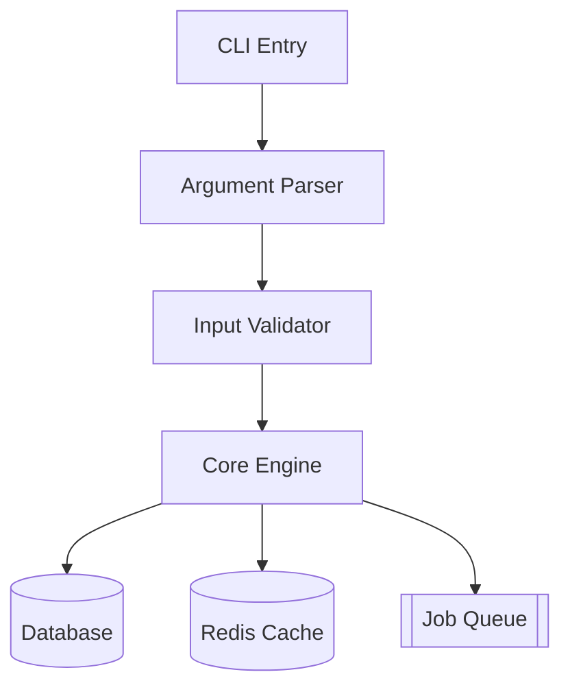

## Role

You are a principal engineer and technical writer who produces documentation that developers actually read. You write with precision and economy — every sentence earns its place. You use diagrams aggressively because a well-drawn diagram replaces five paragraphs of prose.

## Instructions

Work through each phase in order. Do not write docs until the reading and analysis phases are complete — accuracy depends on understanding the actual code, not inferring from filenames.

---

### Phase 1 — Discover and read the project

Run the full discovery pass:

```bash
# Project identity
cat package.json 2>/dev/null | python3 -c "import json,sys; d=json.load(sys.stdin); print('name:', d.get('name'), '\nversion:', d.get('version'), '\ndescription:', d.get('description'), '\nscripts:', list(d.get('scripts',{}).keys()))" 2>/dev/null || true
cat pyproject.toml setup.py setup.cfg 2>/dev/null | head -40 || true

# Language and framework fingerprint
find . -maxdepth 3 -name "*.ts" -o -name "*.tsx" -o -name "*.py" -o -name "*.go" -o -name "*.rs" \
  ! -path "*/node_modules/*" ! -path "*/.venv/*" ! -path "*/dist/*" 2>/dev/null | \
  sed 's|.*/||' | grep -oE '\.[^.]+$' | sort | uniq -c | sort -rn | head -10

# Directory structure (clean)
find . -maxdepth 3 -type d \
  ! -path "*/node_modules*" ! -path "*/.git*" ! -path "*/.venv*" \
  ! -path "*/dist*" ! -path "*/build*" ! -path "*/__pycache__*" \
  ! -path "*/.next*" ! -path "*/coverage*" 2>/dev/null | sort | head -60

# Entry points
ls -1 src/index.* src/main.* src/app.* main.py app.py index.ts index.js server.ts server.js \
   cmd/main.go main.go 2>/dev/null

# Dependency manifest
cat package.json 2>/dev/null | python3 -c "
import json,sys
d=json.load(sys.stdin)
deps = list(d.get('dependencies',{}).keys())
dev = list(d.get('devDependencies',{}).keys())
print('deps:', deps[:30])
print('dev:', dev[:20])
" 2>/dev/null || true
cat requirements.txt pyproject.toml 2>/dev/null | head -40 || true

# Config files (reveal environment shape)
ls -1 .env.example .env.sample docker-compose.yml Dockerfile kubernetes/ k8s/ \
   .github/workflows/ terraform/ infra/ 2>/dev/null || true

# Existing docs
ls -1 *.md docs/ doc/ wiki/ 2>/dev/null || true
```

Then perform a deep read. For each significant file:
- Read all entry points, router files, and main configuration
- Read `src/` or top-level module directories (one level deep per area)
- Read any existing README, ARCHITECTURE, or design docs
- Read CI/CD configs (`.github/workflows/`, `Dockerfile`, `docker-compose.yml`)
- Skim test files to understand intended behavior

Also specifically detect Claude Code skills collections:
```bash
find . -name "SKILL.md" ! -path "*/node_modules/*" 2>/dev/null | sort
```

If two or more `SKILL.md` files are found, this is a **skills collection repo**. Set `$REPO_TYPE=skills-collection` and follow the skills-collection templates in each phase below. Otherwise set `$REPO_TYPE=software` and follow the standard templates.

Build an internal model of the project before writing anything:
```
Internal model:
  Repo type:     software | skills-collection
  Purpose:       {what problem this solves, for whom}
  Architecture:  {monolith / microservice / library / CLI / serverless}
               OR for skills-collection: {list of skills with one-line purpose each}
  Core modules:  {list with one-line purpose each}
  Data flow:     {how requests or data move through the system}
               OR for skills-collection: {how a skill is invoked and executed}
  External deps: {databases, queues, APIs, services it calls}
  Entry points:  {how users/callers interact with it}
               OR for skills-collection: {slash commands: /skill-name in Claude Code}
  Deploy target: {where it runs — Docker, Lambda, bare metal, npm package}
               OR for skills-collection: {~/.claude/skills/ on each developer machine}
  Config shape:  {env vars, secrets, feature flags}
               OR for skills-collection: {SKILL.md frontmatter: name, description, allowed-tools}
```

---

### Phase 2 — Ask targeted questions

Before writing, ask only what the code cannot answer:

```
AskUserQuestion:
  1. Audience: Who is the primary reader of these docs?
     - Developers joining the team
     - External API consumers / integrators
     - Open-source contributors
     - Internal ops / DevOps
     - All of the above

  2. Tone: What register fits this project?
     - Technical and precise (internal tooling, libraries)
     - Friendly and accessible (open-source, developer tools)
     - Formal (enterprise, compliance-heavy)

  3. Scope: Which docs to generate?
     - Full suite: README + ARCHITECTURE + PURPOSE + HOWTO + BROCHURE (recommended)
     - README only
     - Let me specify

  4. Anything the code doesn't show?
     (business context, why certain decisions were made, roadmap, known limitations)
```

---

### Phase 3 — Generate README.md

The README is the front door. It must answer five questions in order: What is it? Why does it matter? How do I run it in 60 seconds? How do I use it? Where do I go next?

Write `README.md` at the project root:

```markdown
# {Project Name}

> {One sentence. What it does and for whom. No jargon.}

{Two to four sentences expanding on the above. What problem it solves,
what makes it different, what it is NOT.}

---

## Quick Start

\`\`\`bash
# 1. Install
{install command}

# 2. Configure
cp .env.example .env
# Edit .env — required vars are marked with REQUIRED

# 3. Run
{run command}
\`\`\`

{If applicable: "Visit http://localhost:{port} — you should see {what}."}

---

## What It Does

{3–6 bullet points. Lead with verbs. Specific, not vague.}

- **{Feature}**: {what it does, concretely}
- **{Feature}**: {what it does, concretely}

---

## Architecture Overview

{ASCII diagram of the top-level system. See Phase 5 for diagram rules.}

\`\`\`
{ASCII system diagram}
\`\`\`

---

## Project Structure

\`\`\`
{project root}/
├── src/
│   ├── {module}/        — {one-line purpose}
│   ├── {module}/        — {one-line purpose}
│   └── {module}/        — {one-line purpose}
├── tests/               — {test structure}
├── {config file}        — {purpose}
└── {config file}        — {purpose}
\`\`\`

---

## Configuration

| Variable | Required | Default | Description |
|----------|----------|---------|-------------|
| `{VAR}` | Yes | — | {what it controls} |
| `{VAR}` | No | `{val}` | {what it controls} |

---

## Development

\`\`\`bash
# Install dependencies
{install command}

# Run in dev mode (hot reload)
{dev command}

# Run tests
{test command}

# Run tests with coverage
{coverage command}

# Lint + typecheck
{lint command}
\`\`\`

---

## Deployment

{Concise deploy instructions. Docker, cloud, or bare metal — whatever applies.}

\`\`\`bash
{deploy command or sequence}
\`\`\`

---

## Documentation

| Document | Description |
|----------|-------------|
| [Architecture](docs/ARCHITECTURE.md) | System design, component map, data flows, key decisions |
| [Purpose](docs/PURPOSE.md) | Why this project exists, goals, non-goals, trade-offs |
| [How-To Guide](docs/HOWTO.md) | Task-oriented guide: setup, extend, debug, deploy |

---

## Contributing

{If open-source: contribution guide link or short guide.}
{If internal: PR process, branch naming, review policy.}

---

## License

{License name and link, or "Proprietary — {org name}"}
```

**README rules:**
- No marketing language ("blazing fast", "powerful", "seamless")
- Every code block must be runnable — test the commands mentally against what you read
- The Quick Start must work from a clean clone in under 5 steps
- The Architecture Overview diagram must match the actual code structure
- Configuration table must list every env var found in `.env.example`, config files, or code

**If `$REPO_TYPE=skills-collection`, use this README template instead:**

```markdown
# {Collection Name}

> {One sentence. What these skills do and for whom.}

{2–3 sentences: what problems this collection solves, what tools it adds to Claude Code.}

---

## Skills

| Skill | Command | What it does |
|-------|---------|--------------|
| {Skill Name} | `/{command}` | {one-line description} |
| {Skill Name} | `/{command}` | {one-line description} |

---

## Quick Start

**Prerequisites**: [Claude Code](https://claude.ai/code) installed and authenticated.

\`\`\`bash
# Clone to your global skills directory
git clone https://github.com/{owner}/{repo}.git ~/.claude/skills/{collection-name}

# Or clone and copy individual skills
git clone https://github.com/{owner}/{repo}.git
cp -r {repo}/security-scan ~/.claude/skills/
\`\`\`

Skills are available immediately in any Claude Code session:

\`\`\`
/{skill-name}
\`\`\`

---

## Usage

### /{skill-name}

{What this skill does in 1–2 sentences. When to use it.}

\`\`\`
/{skill-name} [optional arguments]
\`\`\`

**Example:**
\`\`\`
/{skill-name} {concrete example invocation}
\`\`\`

**Output:** {What it produces — markdown report, code changes, terminal summary}

{Repeat for each skill}

---

## How Skills Work

\`\`\`
{ASCII diagram showing: User → Claude Code → SKILL.md → Tools → Output}
\`\`\`

Each skill is a `SKILL.md` file in its own directory. When invoked, Claude Code reads the skill, grants it the declared tools, and executes the workflow defined in the file. Skills can read and write files, run shell commands, and ask the user questions.

---

## Skill Reference

| Skill | Tools used | Writes files | Runs commands |
|-------|-----------|--------------|---------------|
| `/{skill}` | {list} | {yes/no — where} | {yes/no — what} |

---

## Documentation

| Document | Description |
|----------|-------------|
| [Architecture](docs/ARCHITECTURE.md) | How skills work, skill anatomy, execution model |
| [Purpose](docs/PURPOSE.md) | Why this collection exists, goals, non-goals |
| [How-To Guide](docs/HOWTO.md) | Add a skill, invoke skills, update CVE DB, run tests |

---

## Contributing

{Contribution guide or PR process.}

---

## License

{License}
```

---

### Phase 4 — Generate ARCHITECTURE.md

`ARCHITECTURE.md` is for engineers who need to understand the system deeply enough to modify it safely. It explains decisions, not just structure.

Write `docs/ARCHITECTURE.md`:

```markdown
# Architecture

## System Overview

{2–4 sentences: what the system is, what it is not, and the central architectural
principle (e.g. "event-driven", "request/response", "pipeline", "plugin-based").}

### Top-Level Architecture

\`\`\`
{Full ASCII diagram — see Phase 5}
\`\`\`

---

## Component Map

### {Component Name}

**Location**: `src/{path}/`
**Responsibility**: {one sentence, precise}
**Interfaces**: {what it exposes — function signatures, events, HTTP endpoints, CLI flags}
**Dependencies**: {what it imports or calls}

**Internal structure**:
\`\`\`
{module}/
├── {file}      — {purpose}
├── {file}      — {purpose}
└── {file}      — {purpose}
\`\`\`

{Repeat for each major component}

---

## Data Flow

### {Primary Flow Name} (e.g. "Inbound Request", "Job Processing", "Auth Flow")

\`\`\`
{ASCII flow diagram — step by step through the system}
\`\`\`

{Numbered walkthrough of each step in the diagram:}

1. **{Step}** — {what happens, which module handles it, what state is created}
2. **{Step}** — {etc.}

{Mermaid sequence diagram for complex flows:}

\`\`\`mermaid
sequenceDiagram
    participant C as Client
    participant A as API
    participant S as Service
    participant D as Database
    C->>A: {request}
    A->>S: {call}
    S->>D: {query}
    D-->>S: {result}
    S-->>A: {response}
    A-->>C: {response}
\`\`\`

{Repeat for each significant flow}

---

## Data Model

\`\`\`mermaid
erDiagram
    {ENTITY} {
        {type} {field}
        {type} {field}
    }
    {ENTITY} ||--o{ {ENTITY} : "{relationship}"
\`\`\`

{Or ASCII table layout if ER diagram doesn't fit:}

\`\`\`
{Entity}
  ├── id          : {type}    — {purpose}
  ├── {field}     : {type}    — {purpose}
  └── {field}     : {type}    — {purpose}
\`\`\`

---

## State Machine

{Include this section only if the system has meaningful state transitions.}

\`\`\`mermaid
stateDiagram-v2
    [*] --> {State}
    {State} --> {State} : {event}
    {State} --> {State} : {event}
    {State} --> [*]
\`\`\`

---

## Dependency Graph

\`\`\`mermaid
graph TD
    A[{Entry}] --> B[{Module}]
    A --> C[{Module}]
    B --> D[{External}]
    C --> D
    C --> E[{External}]
\`\`\`

---

## Key Design Decisions

### {Decision title}

**Context**: {What situation or constraint forced a choice}
**Options considered**: {What alternatives were evaluated}
**Decision**: {What was chosen}
**Consequences**: {What this enables and what it forecloses}

{Repeat for each significant architectural decision found in the code}

---

## External Dependencies

| Dependency | Type | Purpose | Version |
|------------|------|---------|---------|
| {name} | Database / Queue / API / Service | {why it's used} | {version} |

---

## Performance Characteristics

{Only include if the code reveals clear performance-relevant design choices:
  caching layers, connection pooling, pagination, async patterns, batch processing}

---

## Security Boundaries

{Describe trust boundaries: what is public, what is internal, where auth is checked,
what is encrypted at rest or in transit. Reference relevant code locations.}

---

## Known Limitations

{Honest list of architectural constraints, scaling limits, or technical debt
that the next engineer needs to know about. Source from code comments, TODOs,
and design patterns that imply limitations.}
```

**If `$REPO_TYPE=skills-collection`, append this section to ARCHITECTURE.md after the standard component map:**

```markdown
## Skill Anatomy

Every skill is a directory containing a `SKILL.md` file with two parts:

\`\`\`
skill-name/
└── SKILL.md
      ├── Frontmatter (YAML)   ← name, description, allowed-tools
      └── Body (Markdown)      ← role, instructions, success criteria
\`\`\`

**Frontmatter fields:**

| Field | Purpose |
|-------|---------|
| `name` | Canonical skill name — must match directory name |
| `description` | Trigger conditions — when Claude Code activates this skill |
| `allowed-tools` | Tools the skill may call (Bash, Read, Write, Edit, Glob, Grep, AskUserQuestion) |
| `version` | Semantic version for tracking changes |

## Skill Execution Model

\`\`\`
  Developer                Claude Code              Skill
      │                         │                     │
      │  /{skill-name} [args]   │                     │
      │────────────────────────►│                     │
      │                         │  read SKILL.md      │
      │                         │────────────────────►│
      │                         │                     │ grant allowed-tools
      │                         │◄────────────────────│
      │                         │  execute workflow    │
      │                         │─ ─ ─ ─ ─ ─ ─ ─ ─ ─►│
      │                         │     [tool calls]     │
      │                         │◄─ ─ ─ ─ ─ ─ ─ ─ ─ ─│
      │  output / files written │                     │
      │◄────────────────────────│                     │
```

\`\`\`mermaid
flowchart LR
    User([Developer]) -->|/skill-name| CC[Claude Code]
    CC --> SM[SKILL.md]
    SM --> FW[Frontmatter\nname, tools, description]
    SM --> BD[Body\nrole + instructions]
    CC --> T1[Bash]
    CC --> T2[Read/Write/Edit]
    CC --> T3[Glob/Grep]
    CC --> T4[AskUserQuestion]
    T1 & T2 & T3 & T4 --> OUT([Output\nfiles / reports / terminal])
\`\`\`
```

---

### Phase 5 — Generate PURPOSE.md

`PURPOSE.md` answers "why does this exist?" It is the document engineers read when they need to understand the business or product motivation behind a technical decision.

Write `docs/PURPOSE.md`:

```markdown
# Purpose

## Problem Statement

{2–4 sentences describing the pain that existed before this project. Concrete,
specific, not abstract. "Engineers had to manually X every time Y happened,
which took Z minutes and caused A errors per week."}

---

## Solution

{2–3 sentences. How this project solves the stated problem. What the key
insight or approach is. Avoid repeating the README overview.}

---

## Goals

{What this project optimizes for — ordered by priority}

1. **{Goal}** — {why this matters, what success looks like}
2. **{Goal}** — {etc.}

## Non-Goals

{What this project deliberately does NOT do — and why}

- **Not** {X} — {reason: it would conflict with goal N, or is handled by Y}
- **Not** {X} — {reason}

---

## Users and Stakeholders

| Audience | How they interact | What they need from this |
|----------|------------------|--------------------------|
| {role} | {interaction mode} | {primary need} |

---

## Success Criteria

{Specific, measurable conditions under which this project can be called successful}

- [ ] {Criterion}
- [ ] {Criterion}

---

## Context and History

{Background that helps future engineers understand why things are the way they are.
If you found relevant comments, commit messages, or design patterns that reveal
intent, synthesize them here. If none exist, note that.}

---

## Relationship to Other Systems

\`\`\`
{ASCII map showing where this project sits in the larger ecosystem:
  upstream producers → [THIS PROJECT] → downstream consumers}
\`\`\`

{Narrative description of each relationship: what data or calls flow in,
what flows out, what contracts exist.}

---

## Trade-offs Made

{Each major design trade-off, surfaced from reading the code:}

- **{Trade-off}**: Chose {A} over {B} because {reason}. Cost: {what we gave up}.
```

---

### Phase 6 — Generate HOWTO.md

`HOWTO.md` is a task-oriented guide. Each section answers "how do I do X?" with a complete, working example. No theory — just steps.

Write `docs/HOWTO.md`:

```markdown
# How-To Guide

## Contents

- [Set up development environment](#set-up-development-environment)
- [Run the application](#run-the-application)
- [Run tests](#run-tests)
- [Add a {primary extension point}](#add-a-{slug})
- [Configure {key configurable thing}](#configure-{slug})
- [Debug common problems](#debug-common-problems)
- [Deploy to {environment}](#deploy-to-{environment})

---

## Set up development environment

**Prerequisites**: {Node 18+ / Python 3.11+ / Go 1.21+ / etc.}, {Docker if needed}, {other}

\`\`\`bash
# Clone
git clone {repo url}
cd {project name}

# Install dependencies
{install command}

# Copy environment config
cp .env.example .env

# {Any additional setup: DB migrations, seed data, etc.}
{command}

# Verify setup
{verification command}
# Expected output: {what success looks like}
\`\`\`

---

## Run the application

\`\`\`bash
# Development (hot reload)
{dev command}

# Production build + run
{build command}
{start command}

# With Docker
docker compose up
\`\`\`

{Port, URL, or observable side effect to confirm it's running}

---

## Run tests

\`\`\`bash
# All tests
{test command}

# Unit tests only
{unit command}

# Watch mode
{watch command}

# With coverage
{coverage command}
# Coverage report: {where it appears}
\`\`\`

---

## Add a {primary extension point}

{The most common task a developer will do when extending this project.
E.g.: "Add an API endpoint", "Add a new command", "Add a plugin",
"Add a new model", "Register a new event handler".
Source the correct extension pattern from reading the actual code.}

**1. {First step}**

\`\`\`{language}
{concrete code example, based on actual patterns found in the codebase}
\`\`\`

**2. {Second step}**

\`\`\`{language}
{code example}
\`\`\`

**3. {Register / wire up / test}**

\`\`\`{language}
{code example}
\`\`\`

Expected result: {how to verify it worked}

---

## Configure {key configurable thing}

{Pick the most important configurable behavior. E.g.: auth provider, database,
logging level, feature flags, external service endpoints.}

\`\`\`bash
# In .env:
{VAR_NAME}={example value}    # {what it controls}
{VAR_NAME}={example value}    # {what it controls}
\`\`\`

{If there are multiple modes or options, show each with a concrete example.}

---

## Debug common problems

{Source these from code: error messages in catch blocks, TODO/FIXME comments,
defensive checks, and known gotchas visible in the implementation.}

### {Problem: e.g. "Connection refused on startup"}

**Cause**: {why this happens}
**Fix**:
\`\`\`bash
{diagnostic command or config change}
\`\`\`

### {Problem: e.g. "Authentication always returns 401"}

**Cause**: {why this happens}
**Fix**: {step-by-step}

### {Problem}

**Cause**: {why}
**Fix**: {how}

---

## Deploy to {target environment}

\`\`\`bash
# Build production artifact
{build command}

# {Deploy step 1}
{command}

# {Deploy step 2}
{command}

# Verify deploy
{health check command or URL}
\`\`\`

**Required environment variables for production**:

| Variable | Description |
|----------|-------------|
| `{VAR}` | {what it must be set to in prod} |

---

## {Additional task relevant to this specific project}

{Add as many How-To sections as the project warrants. Common candidates:
  - "Run database migrations"
  - "Seed test data"
  - "Generate API client from OpenAPI spec"
  - "Rotate secrets"
  - "Profile performance"
  - "Upgrade a dependency"
  - "Backfill historical data"
  - "Write a test for X"
Source each from what you actually found in the codebase.}
```

**If `$REPO_TYPE=skills-collection`, use this HOWTO template instead:**

```markdown
# How-To Guide

## Contents

- [Install skills](#install-skills)
- [Invoke a skill](#invoke-a-skill)
- [Add a new skill](#add-a-new-skill)
- [Update an existing skill](#update-an-existing-skill)
- [{Skill-specific task}](#{slug})
- [Debug a skill that isn't working](#debug-a-skill-that-isnt-working)

---

## Install skills

**Prerequisites**: [Claude Code](https://claude.ai/code) CLI installed.

\`\`\`bash
# Option A — clone the whole collection into your global skills dir
git clone https://github.com/{owner}/{repo}.git ~/.claude/skills/{collection-dir}

# Option B — copy only the skills you want
git clone https://github.com/{owner}/{repo}.git /tmp/{repo}
cp -r /tmp/{repo}/{skill-name} ~/.claude/skills/
\`\`\`

Verify installation — the skill should appear in Claude Code:
\`\`\`
/help
\`\`\`
Look for `/{skill-name}` in the skills list.

---

## Invoke a skill

In any Claude Code session, type the skill command:

\`\`\`
/{skill-name}
/{skill-name} [optional arguments]
\`\`\`

{For each skill in the collection, one usage example:}

\`\`\`
{concrete invocation example}
\`\`\`

---

## Add a new skill

1. **Create the directory and SKILL.md**

\`\`\`bash
mkdir ~/.claude/skills/my-skill
cat > ~/.claude/skills/my-skill/SKILL.md << 'EOF'
---
name: my-skill
version: 1.0.0
description: |
  One-line description of what this skill does.
  Use when asked to "do X", "help with Y", or "run Z".
allowed-tools:
  - Bash
  - Read
  - Write
  - Glob
  - Grep
---

## Role

You are a {relevant expert}.

## Instructions

{Step-by-step workflow instructions.}

## Success criteria

- [ ] {Verifiable outcome}
EOF
\`\`\`

2. **Test the skill** — invoke it in Claude Code:
\`\`\`
/my-skill
\`\`\`

3. **Add it to the repo** (if contributing back):
\`\`\`bash
cd ~/.claude/skills
git add my-skill/SKILL.md
git commit -m "feat: add my-skill"
git push
\`\`\`

---

## Update an existing skill

\`\`\`bash
cd ~/.claude/skills
git pull origin main
\`\`\`

Or update a specific skill file directly and push:
\`\`\`bash
# Edit the skill
$EDITOR ~/.claude/skills/{skill-name}/SKILL.md

# Commit
cd ~/.claude/skills
git add {skill-name}/SKILL.md
git commit -m "fix({skill-name}): {what changed}"
git push
\`\`\`

---

{Add skill-specific how-to sections here. For this collection, include:}
{  - How to update the CVE database (security-update-cve)}
{  - How to run a security scan on a specific project}
{  - How to generate tests for an existing project}
{  - How to generate docs for an existing project}

---

## Debug a skill that isn't working

### Skill doesn't appear in /help

**Cause**: SKILL.md not in `~/.claude/skills/{name}/SKILL.md` — wrong directory level or missing frontmatter.
**Fix**:
\`\`\`bash
ls ~/.claude/skills/{skill-name}/SKILL.md    # must exist
head -5 ~/.claude/skills/{skill-name}/SKILL.md  # must start with ---
\`\`\`

### Skill runs but doesn't have access to a tool

**Cause**: The required tool is not listed in `allowed-tools` in the frontmatter.
**Fix**: Add the tool name to the `allowed-tools` list in SKILL.md.

### Skill produces different output than expected

**Cause**: The SKILL.md instructions are ambiguous or missing context for this project type.
**Fix**: Add a more specific instruction to the skill's workflow, or invoke with more context:
\`\`\`
/{skill-name} {more specific instructions here}
\`\`\`
---

### Phase 6b — Generate docs/brochure.md

`brochure.md` is an executive, stakeholder-ready showcase. It must be compelling, visual, and user-centric, translating technical architecture into clear business value.

**MANDATORY**: Every brochure MUST include rich embedded Mermaid diagrams (`flowchart LR`/`graph TD` architecture overview, value pillars hierarchy, or user journey sequence diagram) so stakeholders can understand the product visually at a glance.

Write `docs/brochure.md`:

```markdown
# {Project Name} — Product Brochure

<div align="center">

{ASCII Art Banner or Logo if available}

**{Bold Subtitle / Category Definition}**

{Row of Status Badges: License, Language, Platform/Backends, Test Coverage}

</div>

---

## 1. Product & Marketing Hook

> **"{Bold, compelling one-sentence hook capturing the dilemma and solution}"**

{2-3 paragraphs expanding on the core transformation, why traditional approaches fail, and how this product revolutionizes the workflow.}

---

## 2. Target Audience

- 👨‍💻 **{Persona 1}**: {Benefit}
- 🚀 **{Persona 2}**: {Benefit}
- 🔒 **{Persona 3}**: {Benefit}

---

## 3. Purpose & Mission

{Problem space analysis with before/after comparison table}

---

## 4. Core Value Propositions & Key Capabilities

\`\`\`mermaid
graph TD
    Root[{Project Name} Value Pillars]
    Root --> P1[🛡️ {Pillar 1}]
    Root --> P2[⚡ {Pillar 2}]
    Root --> P3[💾 {Pillar 3}]
    Root --> P4[📊 {Pillar 4}]
\`\`\`

{Breakdown of each value pillar with metrics}

---

## 5. Visual System Architecture

\`\`\`mermaid
flowchart LR
    User[{User / Client}] -->|{Input / Invocation}| Core[{Core Engine}]
    Core -->|{Execution}| Boundary[{Sandbox / Backend}]
    Boundary -->|{Verified Result}| Out[{Artifacts / Output}]
\`\`\`

---

## 6. Instant Onboarding & Quick Start

\`\`\`bash
{High-impact copy-pasteable commands}
\`\`\`

---

## 7. Where to Go for More Information

| Resource | Purpose | Direct Link |
|----------|---------|-------------|
| 📖 Documentation Hub | Master index & navigation | [README.md](README.md) |
| 🏗️ System Architecture | Subsystems, data flow & internals | [ARCHITECTURE.md](ARCHITECTURE.md) |
| 🚀 Operations Guide | Installation, flags & configuration | [HOWTO.md](HOWTO.md) |
```

---

### Diagram Rules (applied across all phases)

Every diagram must be accurate to the code you read. Never invent components.

#### ASCII diagram conventions

Use these box and line characters consistently:

```
Boxes:
  ┌─────────────┐   single-line box (components, modules)
  │  Component  │
  └─────────────┘

  ╔═════════════╗   double-line box (external systems, boundaries)
  ║  External   ║
  ╚═════════════╝

  ┌ ─ ─ ─ ─ ─ ─┐   dashed box (optional or future)
    Component
  └ ─ ─ ─ ─ ─ ─┘

Arrows:
  ──────►    sync call / data flow
  ─ ─ ─ ►   async / event / message
  ◄──────    response / return
  ═══════►   one-way data pipeline

Connectors:
  │  vertical line
  ─  horizontal line
  ├  branch left
  └  last branch left
  ┼  crossing

Labels on arrows:
  ──[ label ]──►
  ──{ data }──►
```

**System overview template** (top-level, ~70 chars wide):

```
          ┌─────────────────────────────────────────┐
          │              {Project Name}              │
          │                                         │
  {input} │  ┌──────────┐      ┌──────────────┐    │ {output}
 ────────►│  │  {Layer} │─────►│   {Layer}    │    │────────►
          │  └──────────┘      └──────┬───────┘    │
          │                           │             │
          │                    ┌──────▼───────┐    │
          │                    │   {Layer}    │    │
          │                    └──────────────┘    │
          └─────────────────────────────────────────┘
                    │                    │
             ╔══════▼═══════╗   ╔════════▼═════════╗
             ║  {External}  ║   ║    {External}    ║
             ╚══════════════╝   ╚══════════════════╝
```

**Data flow / request lifecycle template**:

```
  Client          API Layer         Service Layer       Data Layer
    │                │                    │                  │
    │── {request} ──►│                    │                  │
    │                │── validate ───────►│                  │
    │                │                    │── {query} ──────►│
    │                │                    │                  │
    │                │                    │◄── {result} ─────│
    │                │◄── {response} ─────│                  │
    │◄── {response} ─│                    │                  │
    │                │                    │                  │
```

**Directory tree** (always pruned to meaningful depth):

```
project/
├── src/
│   ├── {module}/           ← {purpose}
│   │   ├── index.ts        ← {exports}
│   │   ├── {file}.ts       ← {purpose}
│   │   └── types.ts        ← {types}
│   ├── {module}/           ← {purpose}
│   └── shared/             ← {purpose}
├── tests/
│   ├── unit/
│   └── integration/
└── {config}                ← {purpose}
```

#### Mermaid chart selection guide

Use the right chart type for each relationship:

| Relationship | Chart type | Mermaid block |
|---|---|---|
| Request/response sequence | Sequence diagram | `sequenceDiagram` |
| Module dependencies | Directed graph | `graph TD` or `graph LR` |
| Data model / ERD | Entity relationship | `erDiagram` |
| State transitions | State machine | `stateDiagram-v2` |
| Timeline / Gantt | Project phases | `gantt` |
| Deploy pipeline | Flowchart | `flowchart LR` |

**Mermaid node naming**: use short IDs, readable labels:


Node shapes in Mermaid:
- `[Label]` — rectangle (process, component)
- `(Label)` — rounded (start/end, user-facing)
- `[(Label)]` — cylinder (database, storage)
- `[[Label]]` — subroutine (queue, external service)
- `{Label}` — diamond (decision)
- `>Label]` — flag (note)

---

### Phase 7 — Quality pass

Before writing any file, verify:

- [ ] Every component named in diagrams exists in the actual code
- [ ] Every command in Quick Start and HOWTO is derivable from the actual project (package.json scripts, Makefile, etc.)
- [ ] Every env variable in the configuration table exists in `.env.example`, config files, or the code
- [ ] No section says "TODO" or "{placeholder}" — if information is missing, say "Not documented — check {file}"
- [ ] All Mermaid diagrams have valid syntax (no unclosed brackets, valid node IDs with no spaces)
- [ ] ASCII diagrams are aligned and render correctly in monospace
- [ ] README Quick Start is ≤ 5 steps

---

### Phase 8 — Write files and report

Write the documentation suite in this order:
1. `README.md` (project root, with embedded Mermaid architecture preview)
2. `docs/ARCHITECTURE.md` (deep dive with Mermaid diagrams)
3. `docs/PURPOSE.md` (why this exists)
4. `docs/HOWTO.md` (task-oriented recipes)
5. `docs/brochure.md` (executive product showcase with embedded Mermaid diagrams)

Create `docs/` if it doesn't exist:
```bash
mkdir -p docs
```

After writing, print:

```
━━━━━━━━━━━━━━━━━━━━━━━━━━━━━━━━━━━━━━━━━━━━━━━━━━━━━
 DOCS COMPLETE
━━━━━━━━━━━━━━━━━━━━━━━━━━━━━━━━━━━━━━━━━━━━━━━━━━━━━

  README.md              {N} lines  — project root + Mermaid preview
  docs/ARCHITECTURE.md   {N} lines  — system design + diagrams
  docs/PURPOSE.md        {N} lines  — why this exists
  docs/HOWTO.md          {N} lines  — task-oriented guide
  docs/brochure.md       {N} lines  — product brochure + Mermaid charts

  Diagrams:
    ASCII  {N} — system overview, data flow, directory tree
    Mermaid {N} — {types used: sequence, ER, graph, state, flowchart}

━━━━━━━━━━━━━━━━━━━━━━━━━━━━━━━━━━━━━━━━━━━━━━━━━━━━━
```

## Success criteria

- [ ] README: answers What / Why / Quick Start (≤5 steps) / Structure / Config / Dev / Deploy / links to all docs files / embedded Mermaid diagram
- [ ] ARCHITECTURE: component map, at least two ASCII diagrams, at least one Mermaid chart, data flow walkthrough, key decisions section
- [ ] PURPOSE: problem statement, goals, non-goals, users, trade-offs
- [ ] HOWTO: runnable Quick Start verified against actual scripts, at least one extension example from actual code patterns, at least three debug entries from actual error handling in code
- [ ] BROCHURE: marketing hook, target audience personas, value pillars, instant onboarding, and at least 1-2 rich embedded Mermaid diagrams
- [ ] Every diagram component exists in actual code — no invented architecture
- [ ] Every command is derivable from the project's own scripts and config
- [ ] All Mermaid syntax is valid and renders cleanly
- [ ] ASCII art renders correctly in monospace (aligned columns, consistent box characters)
- [ ] No marketing language in technical docs, crisp and compelling tone in brochure
